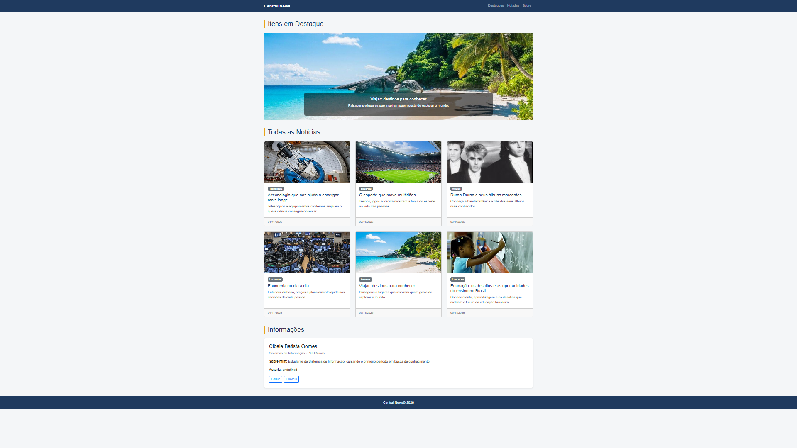

# Central News 📰

## Sobre o projeto

O Central News é um site de notícias desenvolvido como atividade acadêmica, com o objetivo de apresentar informações de diferentes categorias, como Tecnologia, Esportes, Música, Economia, Viagens e Educação.

O site possui uma página inicial com carrossel de destaques e cards de notícias. Ao clicar em uma notícia, o usuário pode acessar seu conteúdo completo e visualizar imagens relacionadas.

## Print do projeto

## Informações Estudantil

- **Nome:** Cibele Batista Gomes
- **Curso:** Sistemas de Informação
- **Instituição:** PUC Minas
- **Código de pessoa:** 1640681